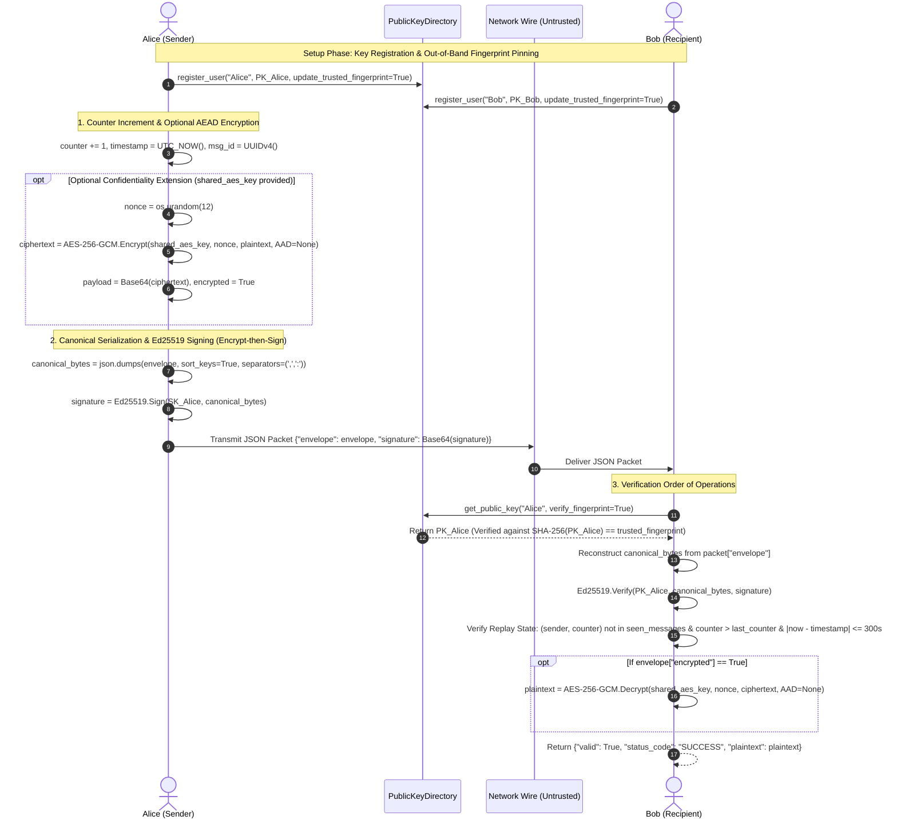

# Academic Security Analysis Report — Project 2: Secure Messaging With Digital Signatures

**Course:** Cryptography & Network Security  
**Project:** Project 2 — Ed25519 Secure Messaging Protocol  
**Repository:** `ed25519-secure-messaging`  
**Execution Environment:** Python 3.10+, `cryptography` (OpenSSL backend), `rich`  

---

## 1. System Design & Architecture

### 1.1 Cryptographic Library & Primitive Selection
The system is constructed upon Python's industry-standard `cryptography` library (`cryptography.hazmat.primitives`), wrapping audited, constant-time C and Rust cryptographic implementations (OpenSSL). Handcrafted mathematical implementations of elliptic curve groups and finite fields are strictly avoided to eliminate side-channel and implementation-level vulnerabilities.

#### Why Ed25519 (RFC 8032)?
We selected **Ed25519** (Edwards-curve Digital Signature Algorithm over the twisted Edwards curve $E : -x^2 + y^2 = 1 - \frac{121665}{121666} x^2 y^2$ over the prime field $\mathbb{F}_{2^{255}-19}$) over legacy RSA-PSS and NIST P-256 ECDSA for four fundamental cryptographic and engineering reasons:

1. **128-Bit Security Level with Ultra-Compact Keys:** Ed25519 provides $\approx 2^{128}$ security against Pollard's rho algorithm for discrete logarithms. Achieving an equivalent security margin with RSA requires 3072-bit keys, which generate enormous signatures and slow key-generation routines. Ed25519 requires only **32-byte public keys** and **64-byte signatures**, minimizing network overhead in high-throughput messaging.
2. **Deterministic Nonce Generation (Eliminating $k$-Reuse Catastrophes):** Standard ECDSA relies on a per-message ephemeral secret scalar $k$ drawn uniformly at random. If the underlying Pseudo-Random Number Generator (PRNG) fails, biases, or reuses $k$ across two distinct messages $m_1$ and $m_2$ (the exact flaw in the 2010 Sony PlayStation 3 firmware signing breach), an eavesdropper can algebraically solve for the private signing key $d_A$:
   $$s_1 - s_2 = k^{-1}(H(m_1) - H(m_2)) \pmod{\ell} \implies k = \frac{H(m_1) - H(m_2)}{s_1 - s_2} \pmod{\ell}$$
   $$d_A = r^{-1}(s_1 k - H(m_1)) \pmod{\ell}$$
   Ed25519 completely eliminates this vulnerability class by deriving the per-message nonce $r$ deterministically via a cryptographic hash of a private key prefix concatenated with the message:
   $$r = \text{SHA-512}(\text{hash\_prefix} \parallel M) \pmod{\ell}$$
   where $\ell = 2^{252} + 27742317777372353535851937790883648493$ is the prime order of base point $B$.
3. **Side-Channel Timing Resistance:** Twisted Edwards curves feature *complete addition formulas* that apply uniformly to all points on the curve (including point doubling and identity additions) without exceptional cases. Combined with branchless Montgomery ladder point multiplication, Ed25519 is intrinsically resistant to timing attacks, simple power analysis (SPA), and differential power analysis (DPA).
4. **High-Performance Verification:** Verification consists of checking $[S]B = R + [k]A$. This requires only two point multiplications and no modular inversions during verification, completing in sub-millisecond durations even on resource-constrained platforms.

---

### 1.2 Protocol Architecture & Mermaid Sequence Diagrams

#### Diagram 1: Normal Signing, Verification, and Optional AES-256-GCM Flow


#### Diagram 2: Public-Key Substitution Attack vs. Out-of-Band Fingerprint Verification

```mermaid
sequenceDiagram
    autonumber
    actor Mallory as Mallory (MITM Attacker)
    participant Dir as PublicKeyDirectory
    actor Bob as Bob (Recipient)

    Note over Mallory,Dir: Attack Setup: Mallory compromises the central directory
    Mallory->>Dir: tamper_registry_key("Alice", PK_Mallory)
    Note right of Dir: registry["Alice"] = PK_Mallory<br/>trusted_fingerprints["Alice"] remains SHA-256(PK_Alice)

    Mallory->>Mallory: Craft envelope with "sender": "Alice", sign with SK_Mallory
    Mallory->>Bob: Send forged_packet

    rect rgb(80, 20, 20)
        Note over Bob,Dir: Part A: Vulnerable Mode (verify_key_fingerprint=False)
        Bob->>Dir: get_public_key("Alice", verify_fingerprint=False)
        Dir-->>Bob: Returns PK_Mallory (Unauthenticated!)
        Bob->>Bob: Ed25519.Verify(PK_Mallory, envelope, sig_Mallory) -> PASSES!
        Bob-->>Bob: valid=True, status_code="SUCCESS" (CRITICAL VULNERABILITY: Forgery Accepted)
    end

    rect rgb(20, 65, 35)
        Note over Bob,Dir: Part B: Defended Mode (verify_key_fingerprint=True)
        Bob->>Dir: get_public_key("Alice", verify_fingerprint=True)
        Dir->>Dir: Compare SHA-256(PK_Mallory) != trusted_fingerprints["Alice"]
        Dir-->>Bob: Raises SecurityError("PUBLIC KEY SUBSTITUTION DETECTED")
        Bob-->>Bob: valid=False, status_code="KEY_SUBSTITUTION_DETECTED" (ATTACK BLOCKED)
    end
```


#### Diagram 3: Replay Attack vs. Signed Monotonic Counter Defense

```mermaid
sequenceDiagram
    autonumber
    actor Alice as Alice (Sender)
    actor Mallory as Mallory (Eavesdropper / Replayer)
    actor Bob as Bob (Recipient)

    Alice->>Bob: Send Valid Packet P1 (counter=1, timestamp=T0, payload="Pay $50 to contractor")
    Note over Mallory: Passively records exact JSON Packet P1 off the wire
    Bob->>Bob: Verify Signature + Check (Alice, 1) not seen -> Record last_counter["Alice"] = 1
    Bob-->>Bob: Accept P1 (status_code="SUCCESS")

    Note over Mallory,Bob: Attack Phase: Mallory replays recorded Packet P1
    Mallory->>Bob: Retransmit identical Packet P1 (counter=1)

    rect rgb(80, 20, 20)
        Note over Bob: Part A: Replay Defense OFF (enforce_replay_defense=False)
        Bob->>Bob: Ed25519.Verify(PK_Alice, P1) -> Mathematically Valid!
        Bob-->>Bob: valid=True, status_code="SUCCESS" (CRITICAL: Duplicate $50 payment executed!)
    end

    rect rgb(20, 65, 35)
        Note over Bob: Part B: Replay Defense ON (enforce_replay_defense=True)
        Bob->>Bob: Ed25519.Verify(PK_Alice, P1) -> Valid
        Bob->>Bob: Check counter=1 <= last_counter["Alice"] (1) OR ("Alice", 1) in seen_messages
        Bob-->>Bob: valid=False, status_code="REPLAY_DETECTED" (Duplicate rejected!)
    end

    rect rgb(20, 65, 35)
        Note over Mallory,Bob: Part C: Mallory increments P1["envelope"]["counter"] = 2 without SK_Alice
        Mallory->>Bob: Send modified P1' (counter=2, original signature for counter=1)
        Bob->>Bob: Ed25519.Verify(PK_Alice, canonical_bytes(counter=2), sig(counter=1))
        Bob-->>Bob: valid=False, status_code="INVALID_SIGNATURE" (Tampering blocked!)
    end
```


---

## 2. Envelope Specification & Canonicalization

### 2.1 Packet Data Structure
Every transmitted message follows a strict, two-tier envelope structure:

```json
{
  "envelope": {
    "sender": "Alice",
    "recipient": "Bob",
    "payload": "Meet me at the library at 4 PM. Bring the project notes.",
    "encrypted": false,
    "nonce": null,
    "counter": 1,
    "timestamp": 1730000000,
    "msg_id": "313b78e6-5043-4cad-bfbe-ac86a1cc34d2"
  },
  "signature": "Z0/1WEmrl42mZPgDoljB9V5it8pMeL4XEaJyZG4BAuopEUBNX0OkxR7+XiIDvkZybSO5bIUCQMN31a9oC+z+AA=="
}
```

### 2.2 Canonical JSON Serialization Rule
Standard JSON serializers produce nondeterministic output due to arbitrary object key orderings, whitespace variations (`{"a": 1}` vs `{"a":1}`), and float representations. Because digital signatures operate over exact binary sequences, any serialization difference between sender and receiver produces an immediate verification failure.

To guarantee cryptographic determinism, the `envelope` dictionary is serialized using canonical RFC 8785 rules:
```python
canonical_bytes = json.dumps(envelope, sort_keys=True, separators=(',', ':')).encode('utf-8')
```
* `sort_keys=True`: Forces strict lexicographical order on all keys (`"counter"`, `"encrypted"`, `"msg_id"`, `"nonce"`, `"payload"`, `"recipient"`, `"sender"`, `"timestamp"`).
* `separators=(',', ':')`: Strips all extraneous whitespace padding around commas and colons.
* `.encode('utf-8')`: Guarantees UTF-8 binary encoding.

### 2.3 Rationale: Binding Metadata Inside the Signed Envelope
A frequent architectural flaw in naive cryptographic systems is signing only the message payload, leaving headers (`sender`, `recipient`, `counter`, `timestamp`) outside the signature's authenticated scope.

If headers were unauthenticated:
1. **Recipient Swapping:** An attacker could intercept a signed wire transfer command meant for Bob and change the unauthenticated `recipient` field to `Mallory`. The receiver would see a mathematically valid signature and credit Mallory's account.
2. **Sender Impersonation / Reflection:** An attacker could change the sender metadata or replay the message in a different protocol context.
3. **Counter / Timestamp Stripping:** An attacker could freely modify sequence counters or rewind timestamps to orchestrate replay attacks without invalidating the payload signature.

By embedding all routing and synchronization metadata directly inside the signed `envelope`, the Ed25519 signature binds the message payload cryptographically to its sender, intended recipient, temporal validity, and sequence position.

---

## 3. Detailed Analysis of the 5 Security Experiments

### Experiment 0: Baseline Authentic Message Exchange
* **Hypothesis:** An untampered packet signed by Alice's private key and verified using Alice's authentic public key will succeed with `valid=True`.
* **Procedure:** Alice signs `"Meet me at the library at 4 PM. Bring the project notes."`. Bob verifies with all defenses active (`enforce_replay_defense=True`, `verify_key_fingerprint=True`).
* **Observed Result:** `valid=True`, `status_code="SUCCESS"`.
* **Cryptographic Explanation:** Bob computes the canonical bytes, retrieves Alice's public key $A$, checks $\text{SHA-256}(A) == \text{trusted\_fingerprint}$, and verifies the equation $[S]B = R + [\text{SHA-512}(R \parallel A \parallel M)]A$. The algebraic equality holds.

---

### Experiment 1: Message Modification & Signature Tampering
* **Hypothesis:** Modifying even a single character in the payload or a single byte in the signature will cause verification to fail with `INVALID_SIGNATURE`.
* **Procedure:**
  1. Payload Tamper: Alice signs `"Transfer $100 to account #4491"`. Attacker intercepts the packet in transit and alters the payload to `"Transfer $900 to account #4491"` without re-signing.
  2. Signature Corruption: Attacker flips 1 byte in the 64-byte Ed25519 signature (`sig_bytes[0] ^= 0xFF`).
* **Observed Result:** Both sub-cases fail with `valid=False`, `status_code="INVALID_SIGNATURE"`.
* **Cryptographic Explanation:** Ed25519 computes scalar $k = \text{SHA-512}(R \parallel A \parallel M) \pmod{\ell}$. Due to the strict avalanche effect of SHA-512, flipping a single bit in $M$ flips $\approx 50\%$ of the digest bits. The computed point $[k]A$ differs entirely from the sender's scalar multiplication, causing $[S]B \neq R + [k]A$. Similarly, altering $S$ invalidates the left-hand point $[S]B$.

---

### Experiment 2: Sender Impersonation Attempt
* **Hypothesis:** An attacker (Mallory) cannot forge a valid signature claiming `sender="Alice"` using Mallory's private key.
* **Procedure:** Mallory constructs an envelope with `"sender": "Alice"`, signs it using `mallory.private_key`, and delivers it to Bob. Bob looks up Alice's authentic public key from the directory.
* **Observed Result:** `valid=False`, `status_code="INVALID_SIGNATURE"`.
* **Cryptographic Explanation:** Verification evaluates $[S]B = R + [k]A_{\text{Alice}}$. However, $S$ was generated using Mallory's private scalar $d_{\text{Mallory}}$, satisfying $[S]B = R + [k]A_{\text{Mallory}}$. Because $A_{\text{Alice}} \neq A_{\text{Mallory}}$, and computing $d_{\text{Alice}}$ from $A_{\text{Alice}}$ requires solving the Elliptic Curve Discrete Logarithm Problem (ECDLP) on Curve25519 (requiring $\approx 2^{128}$ operations), the forgery is mathematically impossible.

---

### Experiment 3: Public-Key Substitution Attack & Defense
* **Hypothesis:** If an attacker replaces Alice's public key in an unauthenticated directory, the verifier will falsely accept forged messages (Part A). Enforcing an out-of-band SHA-256 fingerprint check will detect and block the substitution (Part B).
* **Procedure:**
  1. Mallory compromises the directory and executes `directory.tamper_registry_key("Alice", mallory.public_key)`.
  2. Mallory signs `"Approve wire transfer to offshore account"` with `mallory.private_key`, claiming `sender="Alice"`.
  3. Part A (Vulnerable): Bob verifies with `verify_key_fingerprint=False`.
  4. Part B (Defended): Bob verifies with `verify_key_fingerprint=True`.
* **Observed Result:**
  * Part A: `valid=True`, `status_code="SUCCESS"` (**Vulnerability demonstrated!**)
  * Part B: `valid=False`, `status_code="KEY_SUBSTITUTION_DETECTED"` (**Attack thwarted!**)
* **Cryptographic Explanation:** Digital signatures only authenticate that the message was signed by the private key matching the supplied public key. They provide *zero guarantee* that the public key belongs to the real-world entity "Alice". In Part A, Bob verifies under $A_{\text{Mallory}}$, so the signature matches. In Part B, Bob verifies the public key against an immutable out-of-band SHA-256 digest:
  $$\text{SHA-256}(A_{\text{Directory}}) \neq \text{SHA-256}(A_{\text{Authentic}})$$
  Because SHA-256 is collision-resistant ($2^{128}$ operations) and preimage-resistant ($2^{256}$ operations), Mallory cannot generate a key pair matching Alice's fingerprint.

---

### Experiment 4: Confidentiality Analysis & Optional AES-256-GCM Extension
* **Hypothesis:** Digital signatures alone provide zero confidentiality (plaintext is visible on wire). Combining AES-256-GCM with Ed25519 (Encrypt-then-Sign) provides confidentiality, integrity, and authenticity simultaneously.
* **Procedure:**
  * Part A: Alice signs `"API_SECRET_KEY=sk_live_987654321"` with Ed25519 only. An eavesdropper inspects the wire payload.
  * Part B: Alice generates a 12-byte random nonce, encrypts the payload using AES-256-GCM under a pre-shared 256-bit key, embeds the Base64 ciphertext and nonce into the envelope, and signs the envelope with Ed25519. Bob verifies the signature and decrypts the ciphertext.
* **Observed Result:**
  * Part A: Wire payload is `API_SECRET_KEY=sk_live_987654321` (100% exposed).
  * Part B: Wire payload is pseudorandom Base64 ciphertext (`SohEo7dH/O7uGD...`), nonce is Base64 (`RPsuGivs...`). Bob verifies signature and decrypts to exact plaintext `API_SECRET_KEY=sk_live_987654321`.
* **Cryptographic Explanation:** In Part B, AES-256-GCM provides IND-CPA and INT-CTXT security for confidentiality. The subsequent Ed25519 signature over the envelope (including the ciphertext and nonce) provides non-repudiation and unforgeable authenticity (Encrypt-then-Sign paradigm).

---

### Experiment 5: Replay Attack & Counter / Timestamp Defense
* **Hypothesis:** Replaying a valid, unmodified packet will succeed if no replay defense is enforced (Part A), but will be detected and blocked when monotonic sequence counters and seen-message sets are enforced (Part B). Furthermore, tampering with the counter without the private key will fail signature verification (Part C).
* **Procedure:**
  1. Alice sends `"Pay $50 to contractor"` (counter=1, timestamp=$T_0$). Bob verifies and accepts.
  2. Attacker captures the exact wire packet and replays it to Bob.
  3. Part A: Bob verifies with `enforce_replay_defense=False`.
  4. Part B: Bob verifies with `enforce_replay_defense=True`.
  5. Part C: Attacker increments `counter` to 2 to bypass cache and resends.
* **Observed Result:**
  * Part A: `valid=True`, `status_code="SUCCESS"` (**Vulnerable duplicate executed!**)
  * Part B: `valid=False`, `status_code="REPLAY_DETECTED"` (**Duplicate rejected!**)
  * Part C: `valid=False`, `status_code="INVALID_SIGNATURE"` (**Tampering blocked!**)
* **Cryptographic Explanation:** A digital signature is a static mathematical proof that is valid forever unless bound to dynamic state. In Part A, because the signature remains valid, Bob re-executes the transaction. In Part B, Bob maintains state: $\text{last\_counter}[\text{Alice}] = 1$. The replayed packet has $\text{counter} \le 1$, triggering an immediate rejection. In Part C, altering $\text{counter}$ modifies the canonical JSON bytes, causing Ed25519 verification to reject the packet before any application state is touched.

---

## 4. Deep-Dive Answers to Core Security Questions

### 4.1 Integrity & Authenticity vs. Confidentiality
A common misconception in secure systems design is treating digital signatures as an "encryption" mechanism. 

* **Digital Signatures:** Provide **Integrity** (detecting any modification of $M$), **Authenticity** (verifying origin from the holder of $d_A$), and **Non-Repudiation** (the signer cannot deny producing the signature). However, signatures provide **zero Confidentiality**. The message $M$ travels in plaintext alongside signature $(R, S)$, allowing any passive eavesdropper on the network wire to inspect sensitive payloads.
* **Symmetric Encryption (AES-GCM):** Provides **Confidentiality** (rendering $M$ indistinguishable from random noise under IND-CPA) and symmetric authenticity, but cannot provide non-repudiation because both parties share the exact same key.

### 4.2 The Encrypt-then-Sign Cryptographic Paradigm
When combining confidentiality and digital signatures, three construction patterns exist:
1. **Sign-then-Encrypt:** The sender signs plaintext $M$, then encrypts $(M, \text{sig})$. This allows an eavesdropping recipient to strip the encryption and forward the valid signature to a third party, creating surrogate forward-signing risks.
2. **Sign-and-Encrypt:** The sender independently signs $M$ and encrypts $M$. The signature itself may leak information about $M$.
3. **Encrypt-then-Sign (Our Implementation):** The sender first encrypts $M \to C$ using AES-256-GCM, places $C$, $\text{nonce}$, and metadata inside the envelope, and computes the Ed25519 signature over the canonical serialization of the entire envelope.
   * **Security Advantage:** The verifier validates the digital signature *prior* to decrypting the payload. Malicious or malformed ciphertexts are dropped immediately at the network boundary, completely insulating the decryption routines from chosen-ciphertext attacks (CCA) or padding/format oracle exploits.

### 4.3 The Public-Key Distribution Problem & Trust Bootstrapping
A mathematically flawless digital signature scheme is completely useless if the verifier cannot establish an authentic binding between a public key and the real-world identity of the sender. This is the **Trust Bootstrap Problem**.

Three primary architectural solutions exist:
1. **Out-of-Band Key Fingerprints (Implemented):** Users independently compute a cryptographic hash of their raw public key ($\text{SHA-256}(PK)$) and compare it across a trusted secondary channel (e.g., in-person visual inspection, QR code verification, or Signal safety numbers). This provides secure identity binding without external infrastructure.
2. **Public Key Infrastructure (PKI) & X.509 Certificate Authorities:** A trusted third party (CA) signs an identity certificate containing the user's name and public key. Trust is rooted in hierarchical CA trust stores. Vulnerabilities include rogue CAs, key compromise, and complex revocation mechanisms (CRLs/OCSP).
3. **Key Transparency (e.g., CONIKS, Google Key Transparency):** Modern cryptographic directories utilize verifiable, append-only Merkle trees and cryptographic proofs of consistency. Users can cryptographically audit that the directory service has not secretly substituted keys or presented divergent keys to different clients.

### 4.4 Anti-Replay Mechanisms & State-Synchronization Trade-offs
To prevent replay attacks across an untrusted network, systems deploy combinations of three primitives:

| Primitive | Mechanism | Advantages | Engineering Trade-offs / Limitations |
|---|---|---|---|
| **Monotonic Counters** | Sequential integer $C_{i+1} = C_i + 1$ tracked per sender. | Zero false positives; rejects duplicate and out-of-order deliveries. | Requires strict state synchronization. Messages arriving out of order over UDP/unreliable transport will be dropped unless a sliding window buffer is implemented. |
| **UUID / Nonces** | Cryptographically random unique identifier per packet. | Independent of message order; accommodates asynchronous parallel delivery. | The receiver must store an ever-growing memory cache of all historical message IDs ($O(N)$ state accumulation) or prune after a TTL. |
| **UTC Timestamps** | Epoch timestamp $T_m$ embedded in envelope; rejected if $|T_{\text{now}} - T_m| > \Delta$. | Bounds the necessary cache memory window to $\Delta$ seconds. | Vulnerable to clock skew, NTP spoofing, and replays that occur within the allowable window $\Delta$ unless coupled with a deduplication cache. |

**Our Hybrid Strategy:** Our protocol combines all three:
1. Every packet contains a **Monotonic Sequence Counter** and **UUIDv4**.
2. Receivers enforce a **300-second freshness timestamp window**, allowing safe eviction of stale entries from memory while completely preventing replay attacks both inside and outside the temporal window.